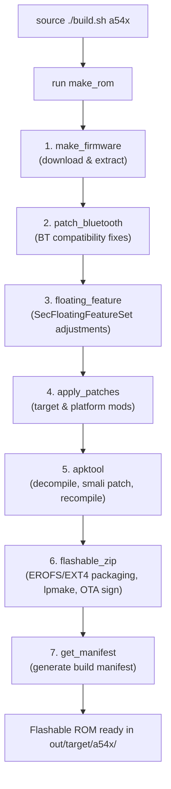

# LichUI ROM Build Guide (Target: Samsung Galaxy A54 5G - a54x)

This comprehensive guide details all the steps necessary to set up your environment, prepare required dependencies, configure stock firmware, and build the **LichUI** custom ROM for the **Samsung Galaxy A54 5G (`a54x` / SM-A546E)** based on the One UI port (Galaxy S23 FE `SM-S711B`).

---

## Table of Contents
1. [System Requirements](#1-system-requirements)
2. [Cloning the Repository & Submodules](#2-cloning-the-repository--submodules)
3. [Building Internal Tools](#3-building-internal-tools)
4. [Stock Firmware Preparation (Critical Step)](#4-stock-firmware-preparation-critical-step)
   - [Download Link](#download-link)
   - [Directory Structure and Creation](#directory-structure-and-creation)
   - [Extraction & Creating the `.downloaded` File](#extraction--creating-the-downloaded-file)
   - [Source Firmware (S23 FE Port Base)](#source-firmware-s23-fe-port-base)
5. [Building the ROM](#5-building-the-rom)
6. [Internal Build Pipeline](#6-internal-build-pipeline)
7. [Build Output](#7-build-output)
8. [Maintenance and Clean Commands](#8-maintenance-and-clean-commands)
9. [Troubleshooting](#9-troubleshooting)

---

## 1. System Requirements

### Recommended OS
- **Debian / Ubuntu**: Verified and tested on **Ubuntu 24.04 LTS** and **Debian 13**.
- **Arch Linux**: Compatible. Requires `clang18` and adding it to `PATH`:
  ```bash
  yay -S clang18
  export PATH="/usr/lib/llvm18/bin:$PATH"
  ```

### Hardware Recommendations
- **Storage**: At least 70–100 GB of free disk space (to extract stock firmware tar files, `super.img`, smali files, and generate final flashable zip).
- **RAM**: 16 GB+ recommended (or 8 GB RAM with 8 GB+ swap).
- **Sudo Access**: Sudo privileges are required for mounting filesystem images and configuring file contexts/permissions.

### Installing Dependencies (Ubuntu / Debian)
```bash
sudo apt update && sudo apt upgrade -y
sudo apt install -y \
    git npm attr unzip tar g++ gcc xxd \
    python3 python3-pip python3-venv openjdk-21-jdk \
    cmake ninja-build clang ccache build-essential \
    pkg-config libssl-dev zlib1g-dev liblz4-dev \
    liblzma-dev libzstd-dev libfuse3-dev libudev-dev \
    libgtest-dev libprotobuf-dev lz4 libbrotli-dev \
    protobuf-compiler perl liblld-dev zip libusb-1.0-0-dev \
    git-lfs zipalign p7zip-full cpio webp
```

---

## 2. Cloning the Repository & Submodules

The project depends on git submodules located in `external/` (`android-tools`, `apktool`, `erofs-utils`, `img2sdat`, `samloader`, `signapk`).

Clone the repository recursively:

```bash
git clone --recurse-submodules https://github.com/MrDemonc/LichUI_Builder.git -b sixteen
cd LichUI_Builder
```

> [!NOTE]
> If you already cloned the repository without `--recurse-submodules`, initialize them with:
> ```bash
> git submodule update --init --recursive
> ```

---

## 3. Building Internal Tools

Before building the ROM, compile the native utilities into `tools/bin` and create the Python virtual environment:

```bash
source ./build.sh tools
```

This compiles:
- `apktool.jar` (with AAPT optimization patch)
- `android-tools` (`lpunpack`, `lpmake`, `simg2img`, `avbtool`, `mkbootimg`, etc.)
- `erofs-utils` (`mkfs.erofs`, `fsck.erofs`)
- `img2sdat`
- `signapk`
- Python virtual environment with `samloader` in `tools/venv/`

---

## 4. Stock Firmware Preparation (Critical Step)

For the **Galaxy A54 5G (`a54x`)** target, `target/a54x/config.sh` specifies:
- **`TARGET_FIRMWARE="SM-A546E/EGY/350356671234567"`**
- **`BOOTLOADER=XXUFEYI4`**

### Download Link
The target stock firmware must be downloaded directly from SamFW:
🔗 **[Download SM-A546E EGY A546EXXUFEYI4 Firmware on SamFW](https://samfw.com/firmware/SM-A546E/EGY/A546EXXUFEYI4)**

### Directory Structure and Creation
The builder processes target firmware inside `out/odin/SM-A546E_EGY/`. Create this folder if it does not exist:

```bash
mkdir -p out/odin/SM-A546E_EGY
```

### Extraction & Creating the `.downloaded` File

1. **Extract the stock firmware:**
   The file downloaded from SamFW will be a `.zip` archive (e.g., `SM-A546E_EGY_A546EXXUFEYI4_fac.zip`). Extract its contents directly into `out/odin/SM-A546E_EGY/`:

   ```bash
   unzip /path/to/downloaded/SM-A546E_EGY_A546EXXUFEYI4_*.zip -d out/odin/SM-A546E_EGY/
   ```

   Confirm that the Odin `.tar.md5` archives are located directly inside `out/odin/SM-A546E_EGY/`:
   - `AP_A546EXXUFEYI4_...tar.md5`
   - `BL_A546EXXUFEYI4_...tar.md5`
   - `CP_A546EXXUFEYI4_...tar.md5`
   - `CSC_...tar.md5`
   - `HOME_CSC_...tar.md5`

2. **Create the empty `.downloaded` flag file:**
   Inside `out/odin/SM-A546E_EGY/`, create an empty file named `.downloaded`:

   ```bash
   touch out/odin/SM-A546E_EGY/.downloaded
   ```

> [!IMPORTANT]
> **Why is `.downloaded` necessary?**
> - **In `scripts/firmware/download.sh`**: The script checks `[ -f "$ODIN_DIR/${MODEL}_${CSC}/.downloaded" ]`. When found, it assumes the firmware is already downloaded locally and **skips remote downloading via samloader**.
> - **In `scripts/firmware/extract.sh`**: The script checks `[ ! -f "$ODIN_DIR/${MODEL}_${CSC}/.downloaded" ]`. If missing, it immediately aborts. When present, it automatically detects the `AP_*.tar.md5` and `BL_*.tar.md5` archives to extract the kernel (`boot.img`, `dtbo.img`), OS partitions from `super.img`, and AVB binaries (`vbmeta.img`).

---

### Source Firmware (S23 FE Port Base)
The builder ports the system image from the Galaxy S23 FE (`SM-S711B/EUX`).

- By default, during the build process, `download.sh` will automatically fetch and unpack the S23 FE firmware via `samloader` into `out/odin/SM-S711B_EUX/`.
- No manual download is required for the source firmware unless your network or FUS connection fails.

---

## 5. Building the ROM

Once tools are built and the A54 firmware is placed inside `out/odin/SM-A546E_EGY/` with `.downloaded`:

### Step 1: Load Environment & Target Configuration
```bash
source ./build.sh a54x
```

> [!NOTE]
> Always use `source ./build.sh a54x` (or `. ./build.sh a54x`) instead of `./build.sh a54x`, because the script sets environment variables and exports the helper function `run` into your current shell.

### Step 2: Start the ROM Build
```bash
run make_rom
```

The build script will execute all tasks sequentially until generating the flashable zip package.

---

## 6. Internal Build Pipeline

When running `run make_rom`, the builder performs the following steps (defined in `scripts/make_rom.sh`):



1. **`make_firmware` (`scripts/firmware/make_firmware.sh`)**:
   - `download`: Detects `out/odin/SM-A546E_EGY/.downloaded` and skips downloading the target. Downloads the source firmware (S23 FE) if needed.
   - `extract`: Unpacks `.tar.md5` archives, unpacks `super.img` with `lpunpack`, unpacks partitions (`system`, `vendor`, `product`, etc.), and extracts SELinux file contexts and filesystem configs.
2. **`patch_bluetooth` (`scripts/internal/patch_bluetooth.sh`)**:
   - Patches Bluetooth libraries for compatibility between A54 vendor and S23 FE system.
3. **`floating_feature` (`scripts/internal/floating_feature.sh`)**:
   - Injects device capabilities into `floating_feature.xml`.
4. **`apply_patches` (`scripts/internal/apply_patches.sh`)**:
   - Runs `customize.sh` patches from `target/a54x/patches/`, `target/a54x/mods/`, and `platform/customization/mods/`.
5. **`apktool` (`scripts/internal/apktool.sh`)**:
   - Decompiles APK/JAR binaries (`framework-res`, `services.jar`, etc.), applies Smali/resource patches, and rebuilds them.
6. **`flashable_zip` (`scripts/packager/flashable_zip.sh`)**:
   - Generates partition images with `mkfs.erofs`, generates dynamic partition images with `lpmake`, creates flashable zip metadata, and signs the package using OTA private keys.
7. **`get_manifest` (`scripts/packager/get_manifest.sh`)**:
   - Generates the build manifest file.

---

## 7. Build Output

Upon successful completion (`LichUI for a54x built successfully`), build artifacts will be located in:

```
out/target/a54x/
├── LichUI_5.2.9_<DATE>_a54x-sign.zip   <-- Recovery flashable ZIP
└── manifest_<DATE>.json                <-- Build manifest metadata
```

This ZIP can be flashed using a custom recovery (such as TWRP or OrangeFox) compatible with the Galaxy A54 5G.

---

## 8. Maintenance and Clean Commands

### Clean Build Workspace
To clean build artifacts without losing downloaded firmwares in `out/odin/`:

```bash
source ./build.sh clear
```
> This deletes `out/firmware`, `out/rom`, `out/apktool`, `out/flags`, `out/rom_workspace`, and `out/rom_assembly`. Your downloaded firmware in `out/odin/` is preserved.

### Show Available Options
```bash
./build.sh
```

---

## 9. Troubleshooting

| Issue / Error | Cause | Solution |
| :--- | :--- | :--- |
| `! The firmware has not been downloaded` | The `.downloaded` flag file is missing in `out/odin/SM-A546E_EGY/`. | Ensure firmware `.tar.md5` archives are extracted there, then run: `touch out/odin/SM-A546E_EGY/.downloaded`. |
| `Sudo access denied` | Sudo permissions are missing or password timed out. | Ensure your user has sudo access. |
| `Script not found: make_rom` | `./build.sh` was executed instead of being sourced. | Source the script: `source ./build.sh a54x` prior to running `run make_rom`. |
| `apktool / aapt errors` | Tools were not built prior to building the ROM. | Run `source ./build.sh tools` first and verify `tools/bin/apktool.jar` exists. |
| `No space left on device` | Out of storage space during extraction or EROFS image generation. | Free up disk space (at least 70–100 GB recommended). |
